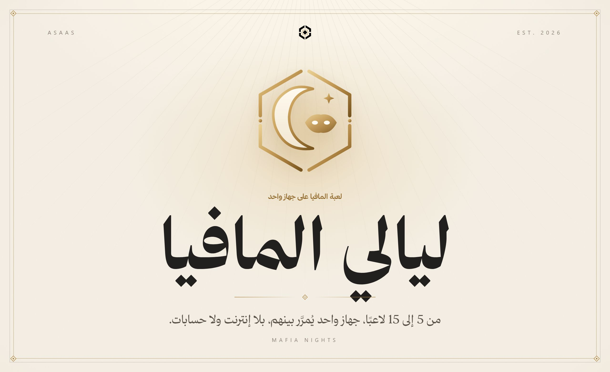
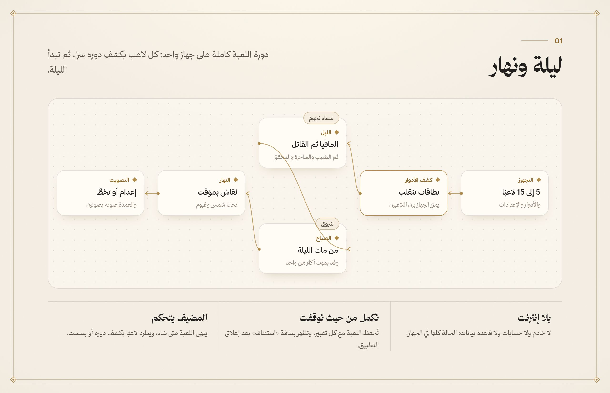
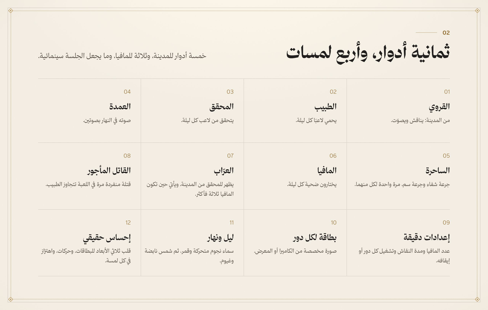
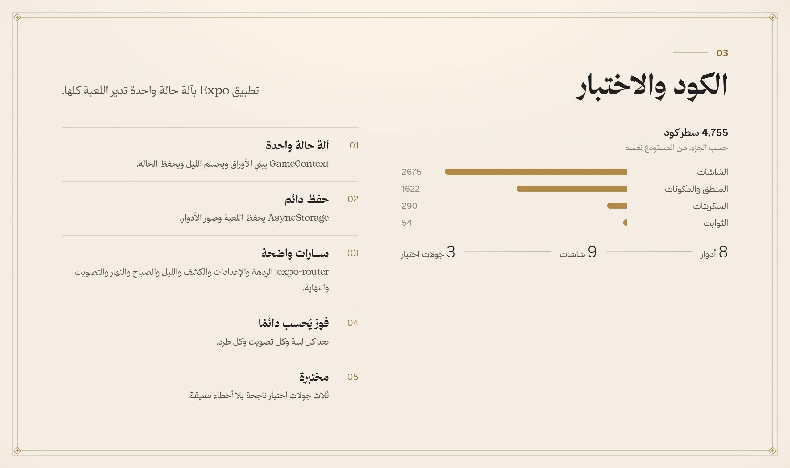
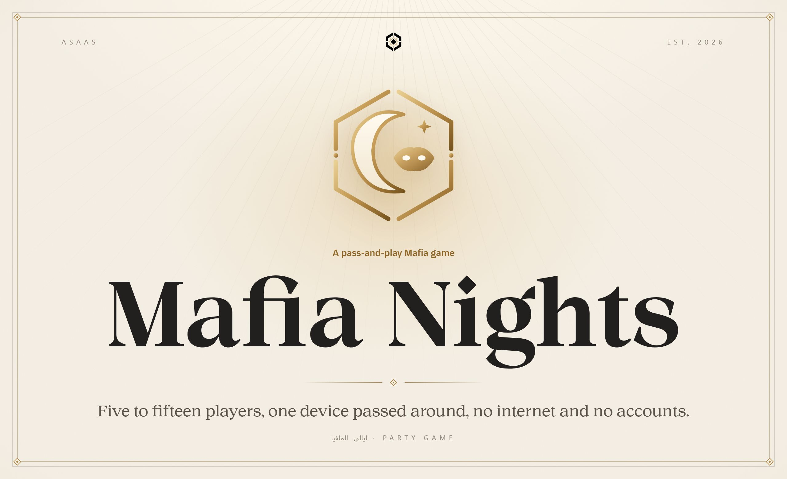
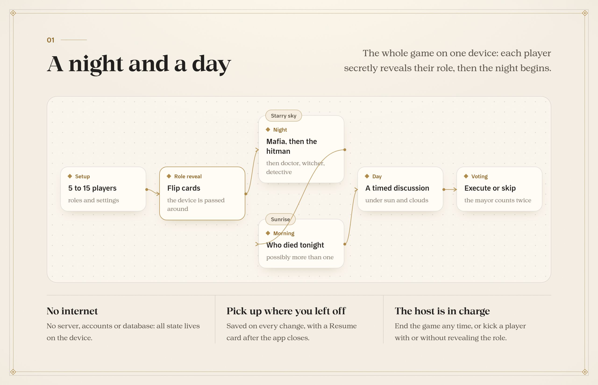
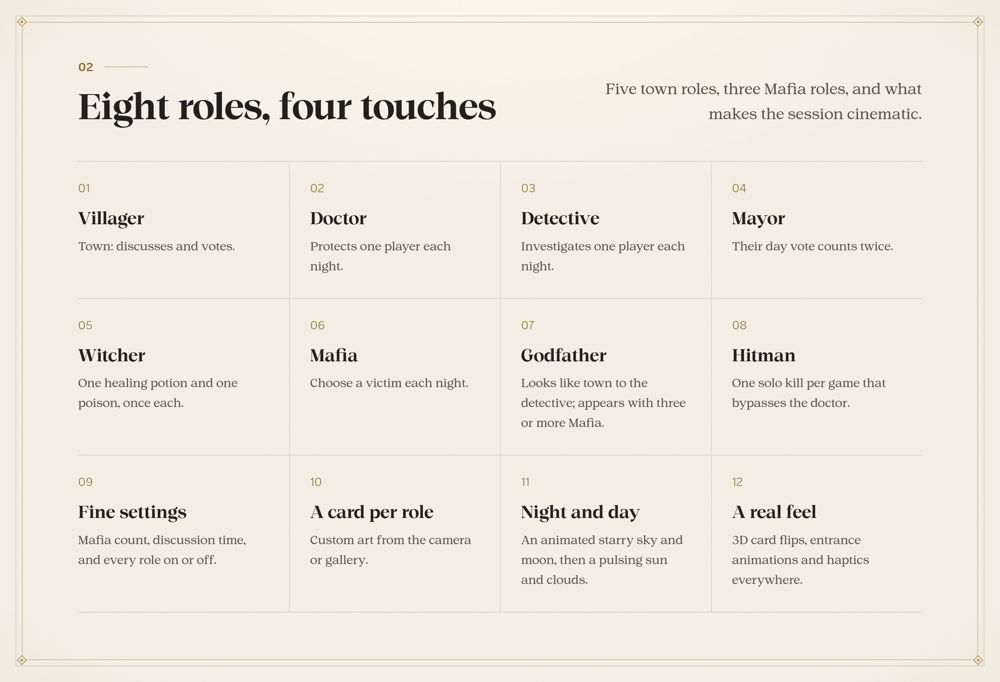
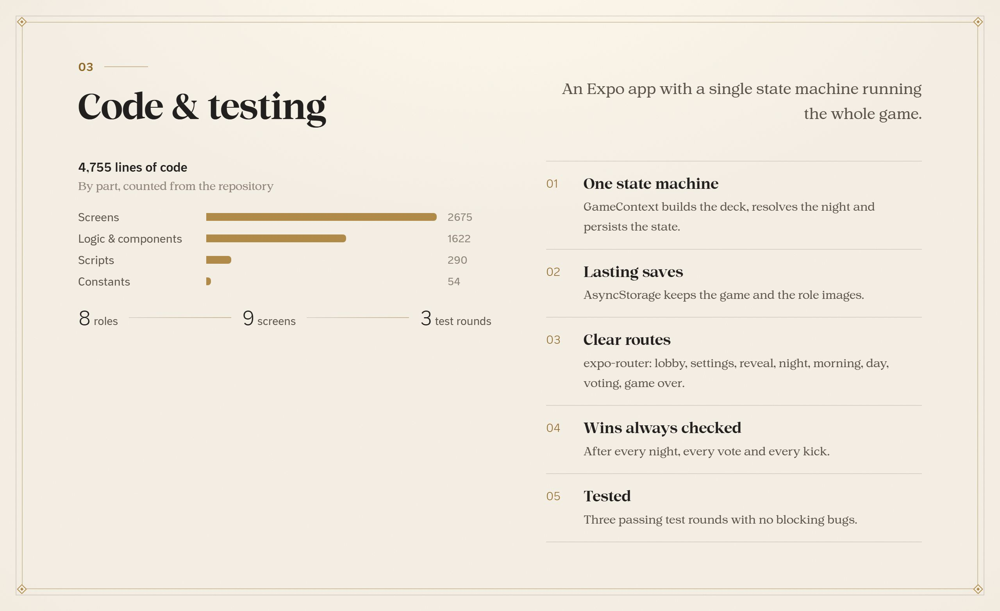

<b>العربية</b> · <a href="#english">English</a>

 

لعبة المافيا الجماعية على جهاز واحد يُمرَّر بين اللاعبين، بلا إنترنت ولا حسابات. ثمانية أدوار بين المدينة والمافيا، وليل ونهار بمشاهد متحركة، وبطاقات تنقلب بثلاثة أبعاد، ومضيف يتحكم في كل شيء، واللعبة تُحفظ فتكملها متى شئت. مبنية بـ Expo وReact Native.

 

<b>الكود في مستودع خاص</b> هذه واجهة العرض العامة لـ«ليالي المافيا». الكود المصدري محفوظ في مستودع خاص، والمساهمة فيه متاحة بدعوة. <a href="https://alaadin-alynaey.site/">تواصل لطلب الوصول أو المساهمة</a>

 

<a href="#arabic">العربية</a> · <b>English</b>

 

The Mafia party game on a single device passed between players, with no internet and no accounts. Eight roles across town and Mafia, an animated night and day, 3D flip cards, a host in full control, and a game that is saved so you can resume any time. Built with Expo and React Native.

 

<b>The source lives in a private repository</b> This is the public showcase of Mafia Nights. The source code is kept private, and contributions are open by invitation. <a href="https://alaadin-alynaey.site/">Get in touch for access or to contribute</a>

 

  جزء من منظومة <b>أساس</b> · Part of the <b>Asaas</b> ecosystem
   
  من تصميم وبناء <a href="https://github.com/AladdinAlynaey">علاء الدين اليناعي</a> · Designed and built by <a href="https://github.com/AladdinAlynaey">Alaadin Alynaey</a>
   
  © 2026 · جميع الحقوق محفوظة · All rights reserved

